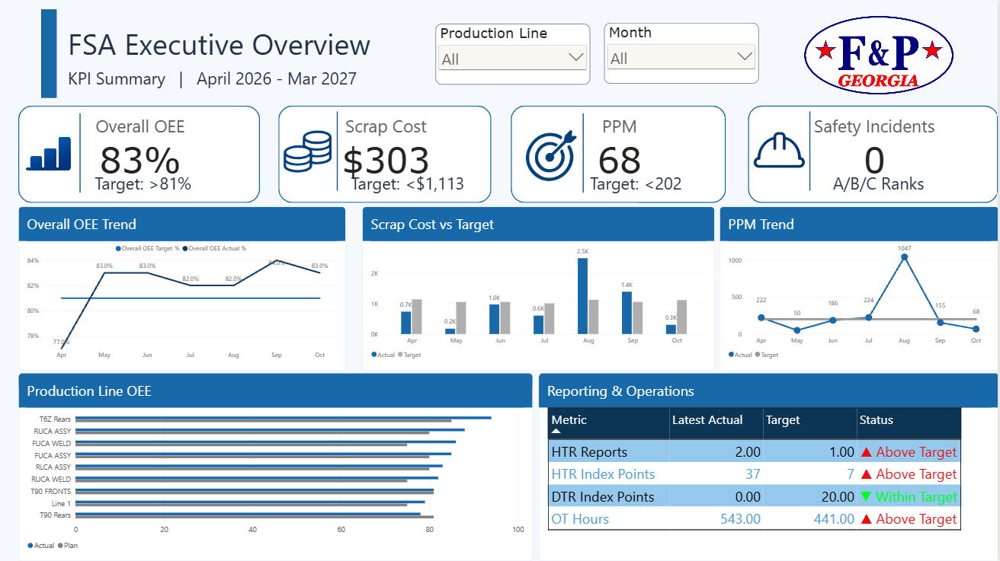
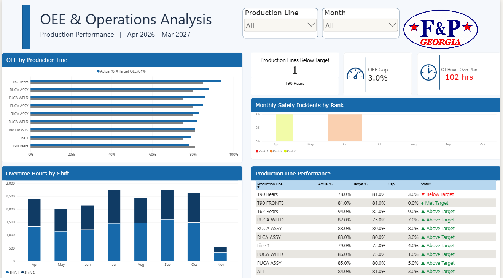

# F&P Georgia — FSA Manufacturing KPI Dashboard

A two-page Power BI dashboard that brings manufacturing performance metrics for F&P Georgia’s FSA building into one report.

## Project Goal

Make monthly manufacturing KPIs easier to review, compare actual performance against targets, and explore results by production line.

## Tools Used

- Microsoft Excel
- Power Query
- Microsoft Power BI

## Data Preparation

Used Excel and Power Query to prepare monthly KPI data for reporting, organize production-line information, and connect reporting tables through a shared month table.

## Dashboard Pages

### 1. FSA Executive Overview

Summarizes key manufacturing metrics:

- Overall Equipment Effectiveness (OEE)
- Scrap cost
- Parts per million (PPM)
- Safety incidents
- HTR and DTR reporting metrics
- Overtime hours

Includes monthly trends, actual-versus-target comparisons, and interactive filters by month and production line.

### 2. OEE and Operations Analysis

Provides a detailed view of operational performance:

- Actual OEE versus target by production line
- Production lines below target
- Overtime hours by shift and month
- Monthly safety incidents by rank
- A performance table showing actual results, targets, gaps, and status

## Skills Demonstrated

- Preparing and transforming data with Power Query
- Organizing multiple KPI tables for reporting
- Building interactive Power BI dashboards
- Comparing actual performance against business targets
- Communicating manufacturing performance through visuals

## Interpretation Notes

Some visuals summarize monthly trends, while KPI cards display the latest available results. These reporting periods should be considered when comparing values.

Targets can vary by production line and month. Performance should be assessed against the applicable target.

## Repository Contents

This repository includes dashboard screenshots and project documentation. The source company data and Power BI file are not included.
